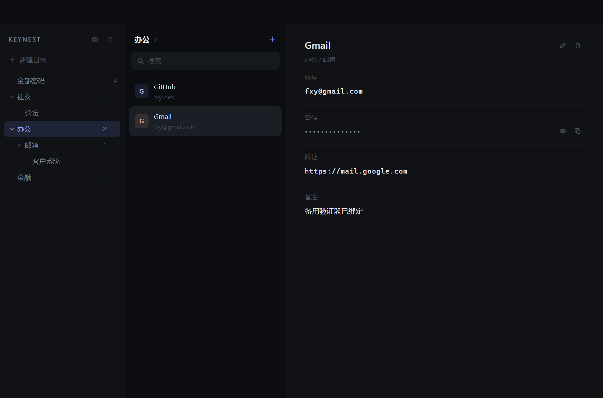
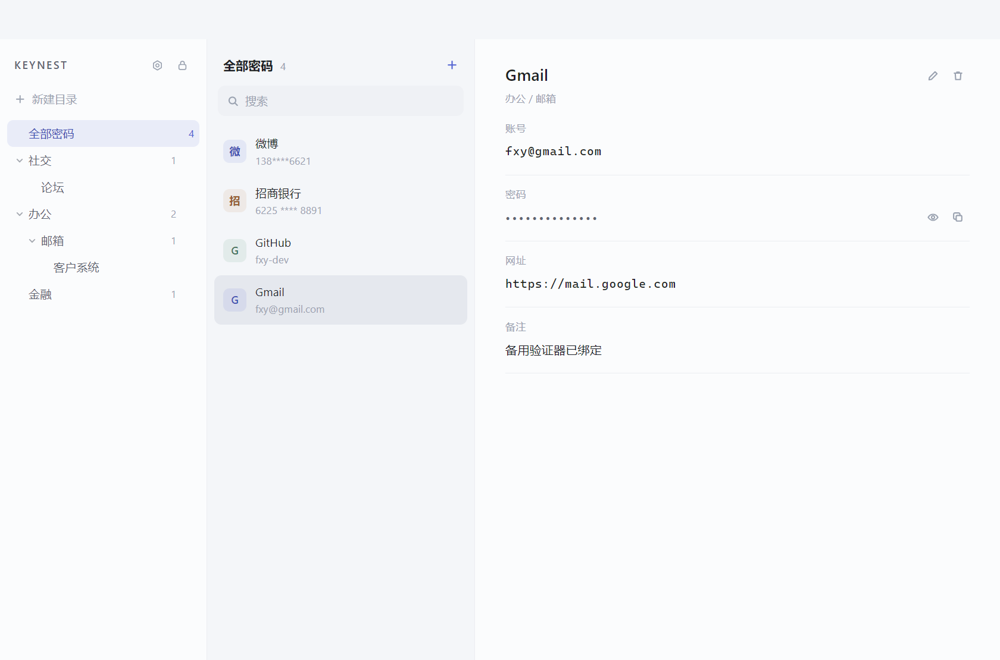

# Keynest

面向个人用户的桌面端密码管理器。界面极简、完全离线，所有密码以 **AES-256-GCM** 加密后只保存在本机，任何情况下都不落明文。



浅色主题：



## 功能

| 需求 | 实现 |
| --- | --- |
| 界面极简 | 三栏布局（目录 / 列表 / 详情），无工具栏、无横幅、无广告位，操作只在需要时出现 |
| 深色 / 浅色主题 | 设置里一键切换，选择写入本地配置，下次启动直接以该主题渲染（不会闪一下深色再变） |
| AES-256 加密本地存储 | scrypt 派生 32 字节密钥 + AES-256-GCM 认证加密，磁盘上只有密文 |
| 禁止明文保存 | 明文仅在解锁期间驻留内存，锁定后立即丢弃；磁盘文件经测试断言不含任何明文 |
| 主密码验证 | 首次运行设置主密码，之后每次打开都需解锁 |
| 系统生物识别 | Windows Hello（指纹 / 面容 / PIN），通过 WinRT `UserConsentVerifier` 调起系统级验证 |
| 验证后才可查看/编辑 | 所有读写 IPC 在未解锁时直接拒绝 |
| 自定义分类 | 内置「社交 / 办公 / 金融」，可任意增删改 |
| 多级目录 | 无限层级，支持展开/收起、新建下级目录、重命名、级联删除 |
| 条目增删改 | 名称 / 账号 / 密码 / 网址 / 备注，支持一键复制、密码显隐 |

## 运行

```bash
npm install
npm start
```

首次启动会要求设置主密码（至少 6 位）。**主密码不会被保存，遗忘后密码库无法恢复。**

打包 Windows 安装包（需先安装打包工具）：

```bash
npm i -D electron-builder
npm run build
```

## 快捷键

| 快捷键 | 作用 |
| --- | --- |
| `Ctrl + L` | 立即锁定 |
| `Ctrl + N` | 新建密码 |
| `Ctrl + F` | 搜索 |
| `Esc` | 关闭弹层 / 取消编辑 |

## 安全设计

**加密链路**

```
主密码 ──scrypt(N=2^15, r=8, p=1, 16B 随机 salt)──▶ 32B 主密钥
                                                      │
明文密码库(JSON) ──AES-256-GCM(12B 随机 IV, AAD=keynest-vault-v1)──▶ 密文 + 认证标签
```

- 每次保存都会用**新的随机 IV**，同一份数据两次加密结果不同。
- GCM 认证标签保证密文被篡改（哪怕 1 bit）时解密直接失败，不会返回错误明文。
- 主密钥只存在于进程内存，锁定时用 `fill(0)` 覆写。
- 修改主密码会用新 salt 重新派生密钥并**重新加密整个库**。

**存储位置**

| 平台 | 路径 |
| --- | --- |
| Windows | `%APPDATA%\Keynest\vault.dat` |

同目录下还有两个文件：`settings.json`（明文偏好设置：界面主题、剪贴板清除秒数）与 `biometric.dat`（仅启用生物识别后生成，DPAPI 封装的主密钥）。

`vault.dat` 结构（全部为密文或公开参数）：

```json
{
  "format": "keynest-vault",
  "version": 1,
  "kdf": { "name": "scrypt", "N": 32768, "r": 8, "p": 1, "salt": "…" },
  "cipher": { "iv": "…", "tag": "…", "data": "…" }
}
```

**生物识别**

启用后，主密钥用系统安全存储（Windows DPAPI，经 Electron `safeStorage`）二次封装后写入 `biometric.dat`。
解锁时必须先通过 Windows Hello 验证，通过后才解封主密钥——**生物识别不能绕过系统验证**，删除 `biometric.dat` 也无法得到密钥。

**其他防护**

- 闲置 10 分钟自动锁定；系统休眠 / 锁屏时立即锁定。
- 复制的密码会自动从剪贴板清除，**默认 30 秒，可在「安全设置」里自定义（5–3600 秒）**；修改后正在倒计时的内容会按新时长重新计算，不会因为调短而继续等待。
- 渲染进程开启 `contextIsolation` + `sandbox`，关闭 `nodeIntegration`，仅通过白名单 IPC 通信。
- 页面配置严格 CSP，禁止内联脚本、禁止外部请求；窗口禁止导航与新开窗口。

## 完全离线

应用不具备任何联网能力，拔掉网线也能完整使用：

- **零运行时依赖**：`dependencies` 为空，打包产物只有 `src/`、图标和 `package.json`，不含 `tools/`、`test/`
- **页面级**：CSP 为 `default-src 'none'` + `connect-src 'none'`，只允许加载本地 `file://` 资源，`fetch` / `WebSocket` / 远程图片全部被拒
- **进程级**：对 `http/https/ws/wss/ftp` 的请求一律 `cancel`；关闭 Chromium 后台联网、组件更新、域名可靠性上报、网络时间同步、翻译与媒体路由
- **系统级兜底**：`host-resolver-rules=MAP * ~NOTFOUND`，任何域名解析恒定失败
- **界面级**：禁止页面导航、禁止新开窗口、禁止 `webview`；摄像头 / 麦克风 / 定位 / 通知等权限一律拒绝
- **无后台通道**：无自动更新、无遥测、无崩溃上报、无远程字体或图标
- **自动化验证**：端到端测试会实测 `fetch`、`WebSocket`、远程图片三种通道全部失败，并断言整轮运行中 `transferSize > 0` 的外部资源数为 0

## 目录结构

```
src/
  main/            主进程
    main.js        窗口、IPC、自动锁定、剪贴板
    crypto.js      scrypt 派生 + AES-256-GCM
    store.js       密文读写（原子写入）
    vault.js       会话与密码库增删改查
    settings.js    偏好设置（主题 / 剪贴板清除时间）
    hello.js       Windows Hello 桥接
    scripts/hello.ps1
  preload/         受控 API 暴露
  renderer/        界面（原生 HTML/CSS/JS，无框架）
test/              核心逻辑自测（node test/crypto.test.js）
tools/             开发脚本：界面预览截图、窗口抓图、端到端冒烟测试、图标生成
```

## 已知限制

- 系统生物识别目前仅支持 Windows（macOS 需改用 Touch ID 接口）。
- 无云同步、无浏览器插件，纯本地单机使用。
- 主密码遗忘无法找回，请自行备份 `vault.dat`（备份文件仍是密文，需要主密码才能打开）。
